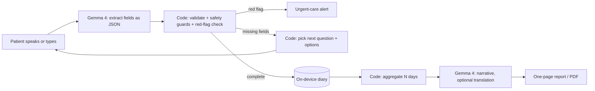

# CareLog

**A private symptom diary for people with chronic conditions, powered by Gemma 4 running entirely on the phone.**

Many patients find it hard to describe how they feel ("it just feels off", "a kind of pressure, I can't explain it"), and by the time they see a doctor the details of the last two weeks are gone. CareLog lets them talk or type in their own words. Gemma turns that into a structured record, the app gently asks for what is missing, and before an appointment it produces a one-page report the doctor can read in a minute.

Built for the [Google Gemma Hardware Hackathon](https://www.agihouse.org/events/the-google-gemma-hardware-hackathon) (Mobile track) on a Pixel 11 Pro.

- **100% on-device.** Gemma 4 runs through [LiteRT-LM](https://ai.google.dev/edge/litert-lm/android) on the phone's GPU. The app's manifest removes the `INTERNET` permission, so it physically cannot send data anywhere.
- **The model understands, the code decides.** Gemma extracts symptoms and writes the report narrative. Which question to ask next, when to stop, and which symptoms are red flags are decided by plain code and a reviewable knowledge file.
- **Bilingual.** The whole app runs in English or Chinese, and a report can be produced in the other language (useful for international students and immigrant families).

## What it does

| Screen | What happens |
| --- | --- |
| **Log** | Describe the symptom by typing or by voice. Gemma extracts it into fixed fields (what, where, since when, how bad, what it feels like, what makes it worse or better, other symptoms, medicines). The app then asks up to three follow-up questions about missing fields, with tap-to-answer options (a 0–10 scale, descriptor words like "throbbing" or "pressure", condition-specific checklists). Red-flag phrases trigger an immediate "call 911" style alert. |
| **History** | Saved entries, stored only in the app's private storage. Two synthetic 14-day demo diaries (English and Chinese) can be loaded with one tap. |
| **Report** | Pick 7, 14 or 30 days and a language. Code aggregates the entries (frequency, severity trend, top triggers, what helped, medicines and their effect, the patient's own words); Gemma writes a short history-of-present-illness paragraph from that summary only. The patient can edit it, add questions for the doctor, and save it as a PDF. |



### Voice input

Two engines, switchable on the Log screen:

- **Phone (offline):** Android's on-device speech recognizer, which on Pixel is Google's on-device speech service. Live captions, automatic end-of-speech, best Chinese accuracy. The app checks which language packs are installed and shows download progress if one is missing.
- **Gemma:** the recording is sent straight to Gemma 4's audio input.

Either way, Gemma does all of the understanding. If the patient answers a question out loud ("nausea, and a bit sensitive to light"), the matching option chips are selected automatically.

### Safety rules in code

- A 0–10 severity score is kept only if the patient's words actually contain a number.
- Generic words ("hurts", "疼") are not accepted as a description of how something feels.
- Red flags (chest pain with breathing trouble, sudden worst headache, one-sided weakness, bleeding, fainting, fever with stiff neck, self-harm) are matched by keyword with simple negation handling, so "no fever" does not trigger.
- The model is never asked to diagnose or suggest medicines, and the report states that it is not a diagnosis.

## Evaluation

36 hand-written test sentences (18 English, 18 Chinese), including vague descriptions, negations ("no fever") and lab values that must not be read as severity. Each field is scored by accuracy or F1, and **hallucinations** count values the patient never said. Everything below was run on a MacBook (CPU) with the same model files the phone uses, unless noted.

| Model and runtime | JSON valid | Hallucinations | Median time per sentence | Notes |
| --- | --- | --- | --- | --- |
| Gemma 4 E2B, GGUF QAT (llama.cpp) | 36/36 | 6 | 2.8 s | Final prompt design (v3) |
| Gemma 4 E2B, LiteRT (phone format) | 36/36 | 14 | 6.7 s | Copied vague onset words from the prompt examples, which led to a prompt fix |
| **Gemma 4 E4B, LiteRT** | 36/36 | **3** | 13.5 s | Best quality |
| MedGemma 1.5 4B, LiteRT | 36/36 | 6 | 54.4 s | Medication F1 only 0.22; not used |
| **Gemma 4 E4B, LiteRT, short output (shipped)** | 36/36 | 4 | 12.2 s | Medication 1.00, onset 0.97, timing 0.86 |

What changed the results most:

1. **One prompt per language.** A single bilingual prompt made the model answer English input in Chinese; separate `extract.en.txt` / `extract.zh.txt` fixed that.
2. **Clear field definitions.** "Only the quality of the feeling itself" for `character`, and "the body part, even when it is part of the complaint" for `location`. With E2B, location and aggravating factors went from 0.89 and 0.91 to 1.00.
3. **Code guards** for severity and generic words, plus never letting the model fill a field from the examples.
4. **Short output.** Omitting empty fields makes the JSON for a short description several times shorter, which matters because generating tokens dominates on-device latency.

On the Pixel 11 Pro (Tensor G6, GPU backend) with E4B: model load 21.6 s at app start, about 9–11 s per extraction with the full-length output, and 12 s for a report narrative. Answers given by tapping options need no model call.

Reproduce with `python/eval_extraction.py` and compare runs with `python/compare_runs.py` (see below).

## Repository layout

```
shared/                 one copy of everything the app and the Python tools both use
  prompts/              extraction (per language), follow-up context, transcription, report, translation
  knowledge/            follow-up questions, condition checklists, red flags (must be clinically reviewed)
  eval/                 36-sentence bilingual extraction test set
  demo/                 synthetic 14-day diaries, English and Chinese
android/                Kotlin + Jetpack Compose app using LiteRT-LM
python/                 prompt iteration, evaluation, report preview (development only, not the demo)
docs/                   sample reports rendered from the demo data
```

The Android app packages `shared/` as assets, so editing a prompt or the knowledge file changes both the app (after a rebuild) and the evaluation.

## Running the app

1. Install Android Studio and open the `android/` folder. If it asks for a Gradle JDK, choose **JVM 21** (Gradle 8.11.1 does not run on Java 25).
2. On the phone, enable Developer options and USB debugging, connect it, and press **Run**.
3. Download a model and push it to the app's folder. The app loads E4B if present, otherwise E2B:

   ```bash
   # https://huggingface.co/litert-community/gemma-4-E4B-it-litert-lm  (or gemma-4-E2B-it-litert-lm)
   adb shell mkdir -p /sdcard/Android/data/com.gemmahack.symptomdiary/files
   adb push gemma-4-E4B-it.litertlm /sdcard/Android/data/com.gemmahack.symptomdiary/files/
   ```

4. Restart the app. The status bar should read "Gemma ready · GPU". Reinstalling with **Run** keeps the model; uninstalling deletes it.

Tested on a Pixel 11 Pro (16 GB RAM, Android 17). E4B needs a phone with plenty of memory; on 8 GB phones use E2B.

## Running the evaluation

The tools use only the Python standard library and talk to any local OpenAI-compatible server.

```bash
cd python
python3 tests/test_core.py                     # model-free unit tests

# Option A: LiteRT-LM, same .litertlm files as the phone
litert-lm import /path/to/gemma-4-E4B-it.litertlm
litert-lm serve &                              # port 9379
python3 eval_extraction.py --base-url http://127.0.0.1:9379/v1 --model gemma-4-E4B-it.litertlm --tag e4b

# Option B: llama.cpp with a GGUF build
llama-server -m gemma-4-E2B-it-qat-UD-Q4_K_XL.gguf --port 8080 -c 8192 --jinja --reasoning-budget 0 &
python3 eval_extraction.py --tag e2b

python3 compare_runs.py e2b e4b                # side-by-side table
python3 interview.py                           # chat through one entry in the terminal
python3 report.py --lang en --out report.html  # report from the demo diary
```

Turn off Gemma 4's thinking mode on llama.cpp (`--reasoning-budget 0`); otherwise it spends the token budget thinking and never writes the JSON.

## Changing behaviour

| To change | Edit |
| --- | --- |
| Extraction rules and examples | `shared/prompts/extract.en.txt`, `extract.zh.txt` |
| Follow-up questions, options, order, maximum number | `shared/knowledge/symptom_knowledge.json` (`slot_questions`, `slot_order`, `max_followups`) |
| Condition checklists and red flags | same file, `conditions` and `red_flags` |
| Test sentences | `shared/eval/extraction_testset.jsonl` (format documented in `eval_extraction.py`) |
| Demo diaries | `python/make_demo_data.py`, then run it |

The Python and Kotlin logic mirror each other: `extraction.py` and `interview.py` match `Interview.kt`; `report.py` matches `Report.kt`.

## Roadmap

- Live voice conversation: Gemma replies out loud, keeping one conversation open so turns are fast.
- PDF download and sharing through the system share sheet.
- Gemma on the Tensor G6 TPU (precompiled E2B) for the conversation, E4B on the GPU for extraction.
- Camera: read a medicine box or prescription label with Gemma's vision input.
- Sleep and heart rate from Health Connect next to symptoms in the report.
- Diary encrypted with a hardware-backed key; "have I felt this before?" search with EmbeddingGemma.

## Disclaimer

CareLog is a hackathon prototype, not a medical device. It does not diagnose or give treatment advice. The red-flag list and condition checklists were written for the demo and must be reviewed against clinical sources before any real use. All demo data is synthetic.
